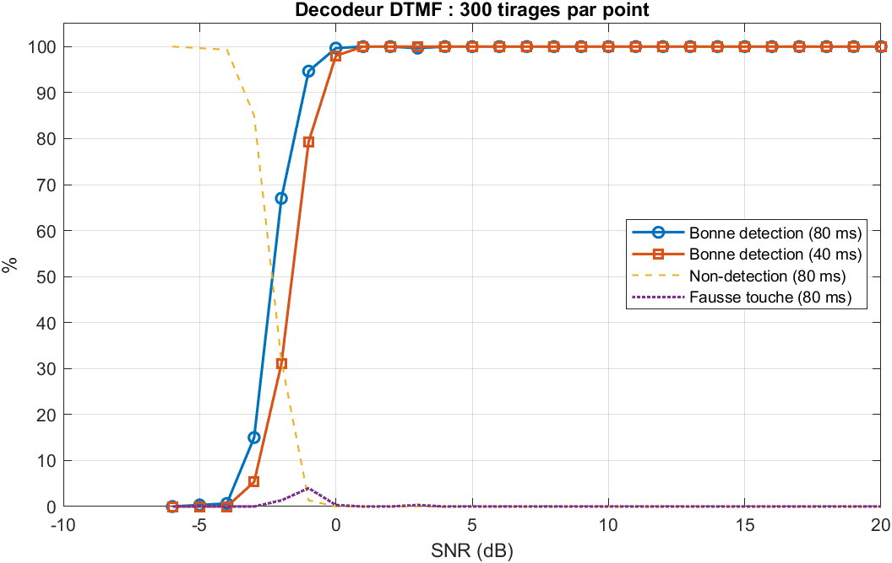

# Décodeur DTMF par l'algorithme de Goertzel

Décodage des tonalités de touches téléphoniques (DTMF) en MATLAB, **sans toolbox** : génération des signaux, algorithme de Goertzel codé à la main et vectorisé, règles de décision normalisées (twist, harmoniques), anti-rebond, puis évaluation Monte-Carlo du taux de bonne détection en fonction du SNR.



## Contexte

Chaque touche d'un clavier téléphonique émet la somme de deux sinusoïdes : une fréquence de **ligne** (697, 770, 852, 941 Hz) et une fréquence de **colonne** (1209, 1336, 1477, 1633 Hz). Pour décoder, il suffit de mesurer l'énergie du signal à ces 8 fréquences. Calculer une FFT complète serait du gaspillage : c'est le cas d'usage typique de l'**algorithme de Goertzel**, qui calcule un seul coefficient de Fourier avec un filtre IIR du second ordre et un seul coefficient réel.

|       | 1209 | 1336 | 1477 | 1633 |
|-------|------|------|------|------|
| **697** | 1 | 2 | 3 | A |
| **770** | 4 | 5 | 6 | B |
| **852** | 7 | 8 | 9 | C |
| **941** | * | 0 | # | D |

## Méthode

1. **Découpage** du signal en blocs de N = 205 échantillons à 8 kHz (≈ 25,6 ms), recouvrement de 50 %. Ce N place les 8 fréquences DTMF à moins de 0,5 bin des fréquences d'analyse.
2. **Goertzel** sur les 8 fondamentales et leurs 8 deuxièmes harmoniques :

   s[n] = x[n] + 2cos(ω) s[n−1] − s[n−2],  |X(ω)|² = s[N−1]² + s[N−2]² − 2cos(ω) s[N−1] s[N−2]

   L'implémentation est vectorisée sur les fréquences et sur les blocs : la seule boucle porte sur les N échantillons.
3. **Décision** pour chaque bloc (critères inspirés de la recommandation ITU-T Q.24) :
   - part de l'énergie du bloc portée par les deux tonalités > 0,4 ;
   - la fréquence retenue dans chaque groupe dépasse la deuxième d'au moins 6 dB ;
   - écart de niveau ligne/colonne (« twist ») < 8 dB ;
   - deuxième harmonique < 20 % de la fondamentale (rejet de la voix et de la musique).
4. **Anti-rebond** : une touche n'est validée qu'après 2 blocs consécutifs identiques, et une seule fois par appui.

## Résultats

| Figure | Contenu |
|---|---|
| `fig1_signal_spectrogramme.png` | Les 16 touches et leur spectrogramme |
| `fig2_spectres_16_touches.png` | Spectre de chaque touche |
| `fig3_decodage_sequence.png` | Décodage d'un numéro à SNR = 10 dB, critère par bloc |
| `fig4_detection_vs_snr.png` | Taux de bonne détection, de non-détection et de fausse touche vs SNR (300 tirages par point) |
| `fig5_confusion.png` | Matrice de confusion à SNR = −2 dB |
| `fig6_detection_vs_duree.png` | Influence de la durée de la tonalité (20 à 100 ms) |

Le script affiche aussi :
- la validation de Goertzel contre la FFT et contre `goertzel()` de MATLAB (erreur relative de l'ordre de la précision machine) ;
- le coût de calcul : 8 × (205 + 3) ≈ 1 660 multiplications réelles par bloc pour Goertzel, contre ≈ 4 100 pour une FFT radix-2 de 256 points.

**Résultats obtenus** (300 tirages par point) :

| Condition | Bonne détection |
|---|---|
| Tonalité de 80 ms, SNR ≥ 0 dB | 100 % |
| Tonalité de 40 ms, SNR = 0 dB | ≈ 98 % |
| SNR = −2 dB (80 ms / 40 ms) | 67 % / 31 % |
| SNR = 5 dB, tonalité de 20 / 30 / ≥ 40 ms | 12 % / 64 % / 100 % |

- **Aucune confusion entre touches** dans la matrice de confusion à −2 dB : les échecs sont tous des **non-détections**. Les fausses touches restent ≤ 4 % (vers −1 dB). Les critères de décision sont volontairement conservateurs, comme dans un vrai récepteur téléphonique, où une touche fantôme est plus gênante qu'un appui à répéter.
- **Durée minimale** : l'anti-rebond exige 2 blocs consécutifs de 25,6 ms (pas de 12,8 ms), soit environ 38 ms de tonalité. On retrouve le gabarit de la recommandation ITU-T Q.24 : détecter les tonalités de 40 ms, ignorer celles de moins de 23 ms.

## Lancer le projet

```matlab
>> main
```

- MATLAB R2021a ou plus récent, aucune toolbox requise.
- Durée : moins d'une minute.
- Pour décoder votre propre enregistrement, placez un fichier `data/mon_enregistrement.wav` (n'importe quelle fréquence d'échantillonnage). Vous pouvez enregistrer les touches de votre téléphone ou utiliser un générateur DTMF en ligne.

## Structure

```
main.m                  script principal (toutes les figures)
src/dtmf_tables.m       clavier et fréquences
src/dtmf_generate.m     génération de signaux DTMF
src/goertzel_power.m    algorithme de Goertzel vectorisé
src/dtmf_decode.m       décodeur complet (décision + anti-rebond)
src/dtmf_eval_snr.m     évaluation Monte-Carlo
src/stft_mag.m          spectrogramme sans toolbox
src/save_fig.m          export des figures
```

## Pistes d'amélioration

- Implémentation en virgule fixe (comme sur un DSP).
- Test sur un enregistrement contenant de la voix pour mesurer le taux de fausses détections (« talk-off »).
- Portage temps réel au micro.